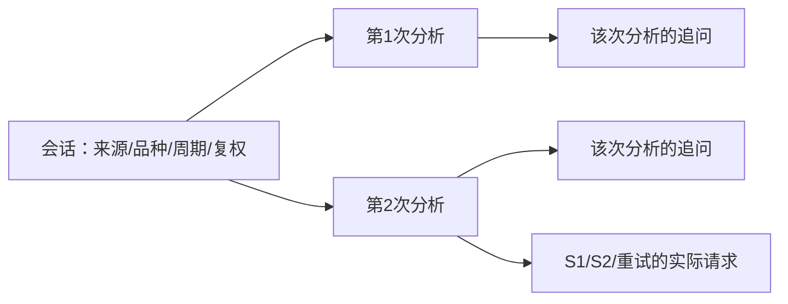

# 会话管理、历史恢复与 DeepSeek Flash 缓存优化开发文档

日期：2026-11-07。审查代码：`6ef9ff2`。状态：开发设计，尚未实现业务改动。

本文把“会话恢复”和“提高模型缓存命中率”作为同一项上下文管理改造：保存完整、可恢复的请求历史，在正确的数据归属下续接已经处理过的前缀。沿用现有两阶段分析、JSON 校验、凭据脱敏与取消机制。

## 1. 要达到的结果

用户可以创建多个独立会话，在每个会话中执行多轮分析和追问，关闭程序后恢复图表、分析结果与对话，再接着分析最新行情。相同品种的两个会话也互不串用历史。

缓存优化的核心目标是：**DeepSeek 官方直连、相同模型与上下文段、缓存仍有效的连续分析/追问，实际输入 token 加权命中率达到 90% 以上，同时降低每轮有效分析总费用。**

不能承诺“任意新会话、任意模型、任意间隔，每次请求都超过 90%”。首次冷启动没有相应缓存；长时间离开后服务端可清理缓存；全量行情修订和上下文重建也会形成新前缀。必须同时公布含这些调用的总体命中率与费用，不能只展示最好的一次。

第一版包含：会话列表、新建/重命名/归档、分析时间线、恢复查看、恢复追问、继续分析、旧文件导入、逐请求用量与费用估算。暂不要求多个会话同时运行分析，也不恢复一半的 HTTP 流或自动重发中断请求。

## 2. 官方机制与价格依据

### 2.1 指定模型的实际服务版本

截至本文核对日期，DeepSeek 官方说明：`deepseek-v4-flash` 仍可作为模型名调用，但原对应模型已下线，请求由 **DeepSeek-V4.1-Flash-1017** 提供服务，按 Flash 价格计费；当前推荐名称为 `deepseek-flash`。[来源 1]

本方案保留用户现有模型选择，不擅自修改配置。请求记录应分别保存配置模型名、实际发送模型名、响应返回模型名。不能把别名可调用解释为原 V4 模型仍在提供服务。

官方当前上下文长度为 **1M**。项目 `AIProviderSettings.context_window` 当前默认 2,000,000，开发时应把模型能力与手动覆盖分开；不能继续用该默认值推断 Flash 可接受 2M 上下文。

### 2.2 当前人民币价格

以下均为每百万 token、DeepSeek 官方直连价格，不代表第三方转发商报价。[来源 1]

| 类型 | 空闲时段 | 高峰时段 |
|---|---:|---:|
| 输入：缓存命中 | ¥0.02 | ¥0.04 |
| 输入：缓存未命中 | ¥1.00 | ¥2.00 |
| 输出 | ¥4.00 | ¥8.00 |

北京时间/香港时间周一至周五、不含中国法定节假日的 09:00–12:00、14:00–18:00 为高峰；其余为空闲，包括周末全天。2026-11-07 为周六，因此本文优先展示空闲价格。价格核对日期必须显示，费用是估算，实际账单以服务商为准。

这里缓存输入是未命中单价的 **2%**，不是项目状态栏当前文案声称的 10%。状态栏不能继续硬编码该比例。

### 2.3 不能再只按最长公共文本推断命中

DeepSeek 当前缓存文档说明了 Sliding Window Attention 下的**完整缓存前缀单元匹配**：[来源 2]

1. 用户输入结束、模型输出结束时，会形成缓存前缀单元。
2. 多个请求被识别出共同前缀时，也会为共同前缀建立单元。
3. 长输入/输出中还会按一定 token 间隔建立单元；文档没有给出可依赖的固定间隔值。
4. 后续请求必须完整匹配已落盘单元，才能使用该单元。
5. 建立缓存耗时为秒级；不用后通常几小时到几天清理，属于尽力而为。

因此 `A+B → A+B+C` 更容易复用已经完成的一次输入；`A+B → A+C` 即便有长 A，也不代表第二次立即命中 A。文档举例是在共同前缀识别落盘后，后续请求才命中。

本地字节相同、token 公共前缀比例只能解释“有多少内容具备复用条件”，**不能替代 API 返回的 `prompt_cache_hit_tokens`**，也不能许诺服务端持续保留缓存。不要套用其他厂商的 `cache_control`、`prompt_cache_key` 或固定保留时间参数。

### 2.4 思考内容与缓存

当前项目普通分析未携带 `tools`。按 DeepSeek 官方规则，这种情况下历史 `reasoning_content` 不必回传，回传也会被忽略；不要为了提高缓存率把长思考过程强行放进普通 `content`。[来源 3]

若未来增加工具调用，携带 `tools` 的后续请求需要按官方规则回传对应 reasoning 字段；应作为另一条明确支持的请求路径实现，不能与当前无工具分析混用。输出费用应按实际返回的 `completion_tokens` 计量，不要只统计可见 JSON 长度，也不要重复加算已经包含的 reasoning token。

## 3. 现有缓存为什么仍低

### 3.1 保存记录中的真实 API 统计

本次读取现有记录，仅提取数字、消息角色和模型名，不导出凭据或私人提示词。

2026 年 11 月保存的 7 份分析记录，包含 14 份阶段最终响应：总输入 **998,440**，缓存命中 **503,040**，最终响应加权命中率 **50.3826%**，输出 **124,144**。这不是整个账户账单：部分分析有重试，单阶段保存的最终响应不能代表所有 attempt。

| 时间 | 阶段 | 输入 token | 命中 token | 命中率 |
|---|---|---:|---:|---:|
| 11-04 16:20 | S1 | 60,405 | 46,080 | 76.3% |
| 11-04 16:20 | S2 | 70,318 | 23,552 | 33.5% |
| 11-05 23:55 | S1 | 60,456 | 46,080 | 76.2% |
| 11-05 23:55 | S2 | 73,027 | 33,408 | 45.7% |
| 11-07 12:31 | S1 最终响应 | 73,017 | 60,160 | 82.4% |
| 11-07 12:31 | S2 | 71,229 | 14,336 | 20.1% |

这些 S2 保存为 `system,user,assistant`，是独立请求形态。**代码默认改为 chain，不等于旧配置或实际调用已经使用 chain。** 新界面必须显示实际采用的形态及原因，不只展示配置默认值。

### 3.2 代码中的具体原因

| 位置 | 当前行为 | 影响 |
|---|---|---|
| `prompt_assembler.build_stage2_continuation` | S1 后追加很长 S2 任务，包括重复的基础规则、输出要求、相关策略等 | 即便复用 S1，S2 新尾部仍很大，达不到 90% |
| `validation_retry.append_assistant_turn` 与上述方法组合 | 成功的 S1 messages 已含最终 assistant；S2 又追加一次归一化 assistant | 重复诊断，不必要增加输入；不能完整直接复用原输出后立即接任务 |
| `_normalize_stage1_assistant_for_chain` | 用校验后的字典重新 `json.dumps(indent=2)` | 真实管线又生成不同文本的诊断副本；归一化结果应与原始请求历史分开 |
| `build_incremental_stage1` | 每次只抽取旧第一条 user，重建四条消息 | 丢弃中间新增棒；不同轮又改写后面的诊断，不能形成持续追加的真实历史 |
| `_build_stage1_user_prompt` | 新 full 分析重发最新棒在前、带 K1 重编号的整张表 | 新棒出现时表格前端就变化，后面的历史数据不能当作未变前缀 |
| `FreeChatSession.send` | 请求含 `user_content` 行情表，历史及 JSONL 却只保存 `user_text` | 下一轮移除了上一轮行情，前缀从旧 user 位置断开；重启也恢复不了原请求 |
| `FreeChatSession._build_prefix` | 追问使用新的短 system 和摘要前缀 | 不能自然继承 S2 大前缀；第一条追问应单独看待 |
| `SessionTokenLedger` | 累计输入+输出被叫作 context_used | 重复发送历史会累计消费，但不代表当前请求上下文已经用满 |

此外，本轮审查已证明跨复权复用旧价格、会话切换后旧追问回调污染和关窗线程超时仍崩溃。会话功能必须一起修到新链路中，否则恢复更多历史反而扩大这些错误。

### 3.3 离线请求结构测量

使用 100 根合成棒、当前默认 Settings、5 个相关上涨通道策略、真实 assembler 和生产 assistant 追加逻辑测量。计数器为 `cl100k_base` 加显式角色分隔的代理表示，**不是 DeepSeek tokenizer**，绝不能当作真实命中率。[本地证据 A]

| 转换 | 新请求代理 token | 可重复前缀候选占比 |
|---|---:|---:|
| 完整 S1 输入及原回答 → 当前 chain S2 | 146,580 | 61.04% |
| 增量 S1 输入及原回答 → 当前 chain S2 | 154,463 | 62.96% |
| 追问第 1 轮及原回答 → 第 2 轮 | 10,223 | 29.95% |

完整 chain S2 的新尾部约 57,107 代理 token，其中 S2 任务约 55,860，重复归一化 assistant 约 1,249。**只删除重复 assistant 不足以从约 61% 到 90%；主要工作是让规则和历史真正复用。**

## 4. 会话功能与交互

### 4.1 层级



会话绑定规范化后的来源、品种、交易所、周期和复权。一个品种可以建立多个独立会话。改变这些条件默认新建会话；从某次历史分析另起会话时保存来源分析 ID，后续增量在新会话内查找。

### 4.2 界面

左侧增加会话列表，支持标题、品种、周期、最近活动、归档。中间时间线显示每次分析的时间、所用行情时间、结论、追问与失败状态；内部校验重试默认折叠。

打开会话恢复所选分析的历史图表、指标、诊断、决策树、原始回答和追问，不触发模型、声音、交易 CSV 或外部通知。提供两个明确动作：

- **继续追问**：默认围绕选中的历史分析和其行情快照。可主动选择附加“最新行情”，界面显示数据时间。
- **获取最新行情并分析**：按该会话配置获取数据，追加一轮分析；合适时增量，不合适时完整分析。

第一版同一时刻执行一个模型任务。可以切换查看其他会话，任务始终归属原会话；行情刷新/持续跟踪只属于明确标记的活动运行会话。用户点击另一个会话不能偷偷改变旧任务的数据源或快照。

## 5. 存储与恢复

### 5.1 SQLite 为主存储，原文件继续兼容

采用标准库 SQLite，位置建议 `records/sessions.sqlite3`。数据库保存新的业务记录；现有 JSON/JSONL 作为兼容导入与导出继续保留，不让两份存储互相决定状态。

| 表 | 关键字段 |
|---|---|
| `sessions` | `id`、标题、来源/品种/交易所/周期/复权、创建/更新时间、当前选中分析、分析上下文头请求 ID |
| `analyses` | `id`、`session_id`、上次分析 ID、来源分析 ID、完整/增量类型、状态、原 `AnalysisRecord` JSON、当次配置、图表及指标快照 |
| `followups` | `id`、`analysis_id`、轮次、展示问题、实际 user 消息、回答/思考、状态 |
| `requests` | `id`、`analysis_id`、可选 `followup_id`、上一上下文请求 ID、阶段、attempt、状态、实际消息/参数、原始响应、usage、服务商请求 ID、时间 |
| `legacy_imports` | 原文件路径、JSONL 行号或记录类别、已导入主键 |

使用普通主键、外键、事务和唯一约束，例如追问 `(analysis_id, turn)` 唯一、旧导入 `(source_path, item_type, line_no)` 唯一。每线程独立连接、短事务，不在等待 API 时持有写事务。

归属与恢复字段放数据库列或新外层模型，继续将原 `AnalysisRecord` 作为 JSON 载荷，不向其 `extra='forbid'` 模型直接塞入新字段。数据库结构更新用普通版本迁移。

本功能不需要新增内容 hash、冻结 contract、baseline 或额外发布门禁。保留现有校验和安全措施。

### 5.2 三种数据必须分开

1. **展示时间线**：问题原文、结论、回答、失败状态；不默认展开行情表和内部反馈。
2. **用于续接的 API 历史**：实际 user 内容、原始 assistant 内容及所需 provider 字段，保留消息顺序与角色。
3. **每次 API 请求记录**：客户端转换之后、发出之前的实际消息和非敏感参数，以及响应和 usage。

现有 `stage1_messages/stage2_messages` 已保留最终累计重试链，不能说它们完全没有保存重试。但成功链中包括最终 assistant，不等于某次发起前的请求。新 `requests` 应逐 attempt 记录，不能再从最终 messages 猜请求边界。

所有新存储与导出继续经过现有共享凭据脱敏；不存 API Key、Authorization、代理密码或可用的加密凭据副本。若内容因脱敏发生改变，则恢复后的文本不能被标成原请求精确副本；不能为维持缓存而恢复明文保存。

### 5.3 图表与模型配置

新分析保存实际展示所用指标数组，必要时保存指标预热输入。只凭现有 `kline_data` 重算 EMA/ATR，可能与原运行不同，不能承诺“原图逐值恢复”。

历史记录保存当时来源、复权与非敏感模型参数；实际请求使用当前可用的凭据。模型、provider 或提示词内容变化时建立新的上下文段，不原位重写已发送历史。界面展示实际变化及其费用影响。

### 5.4 旧文件导入

旧 JSON 按实际文件路径建立导入映射；sidecar 用源文件名匹配，兼容过去的 basename 差异。partial 文件先处理 `_partial_reason` 再校验。JSONL 逐行读取，损坏尾行不影响前面完整记录。

旧记录缺来源、复权、实际追问快照等字段时保留“未知”，不套用当前设置猜测。它们可以恢复查看；继续操作时形成新上下文，不能声称精确恢复旧追问或命中旧缓存。

## 6. 请求归属、切换与中断

Worker 启动时固定 `session_id / analysis_id / request_id`、来源、品种、周期和快照。快照在 GUI 提交侧准备完成后交给 worker；worker 不再调用旧 MainWindow 的快照闭包，不在网络执行过程中用 `BlockingQueuedConnection` 等待 GUI。流式回调、完成、错误和落盘均使用该归属。只有视图仍选中同一任务时，回调才更新当前面板；后台完成仍写原会话。

追问面板不能继续持有未解绑的旧 session。输入可用性由控制器的当前任务状态决定，不能由任意旧 worker 的完成回调直接启用。历史恢复使用纯展示方法，不直接调用现有包含通知的 `_on_analysis_finished()`。

请求发出前保存 `running`；流式片段在内存合并，可定时更新同一行；结束时一次事务提交回答、状态和 usage，不为每个 token 创建数据库行。启动时将遗留 running 标记为 interrupted，保留收到的正文，不自动重发。用户重试创建新 request，旧调用及未知用量仍保留。

取消只表示本地请求停止，不保证服务端未运行或未计费。运行中 QThread 不能随面板析构；超时后解除其面板所有权，由更长生命周期的管理器等待回收，不强行 terminate。

最后一个窗口关闭时，仅换线程 parent 仍不足够：QApplication 退出也可能销毁管理器。关闭流程应进入“退出中”，停止新任务、取消请求并以执行器支持的方式中断网络等待，继续处理事件，在线程回收后才销毁管理器并真正退出。不得在 GUI 线程长期 join 仍等待 GUI 回调的 worker；相应取消路径要用阻塞 I/O 和最后窗口退出场景实际验证。

## 7. 怎样使热态命中率真正超过 90%

### 7.1 先算出必要条件

设当前请求实际可命中的 token 为 H，新处理部分为 U：

```text
输入命中率 R = H / (H + U)
R >= 90% 需要 U <= H / 9
```

例如可复用 60,000 token，未缓存部分必须不超过约 6,667；新尾部若仍有 50,000，单靠 chain 开关无法到 90%。

这里 H 必须是服务端实际可使用的缓存量。本地公共前缀 P 只有候选性质：即使 `P/(P+U)>90%`，缓存尚未落盘或已被清理，实际 R 也可能低得多。

### 7.2 主方案：保留完整输入，只在尾部增加新任务

把“分析历史”和“某次分析的追问历史”分别持久化，避免把任意追问改写为下一轮分析的指令。共享业务记录，两条 API 历史各自追加。

分析请求按下面的方式演进：

```text
首次 S1：共同规则 + S1 必需说明 + 初始行情 + S1 任务
首次 S2：上述全部 + S1 原回答 + S2 必需说明/本轮相关策略 + S2 任务
下一 S1：上述全部 + S2 原回答 + 新棒/变更数据 + 当前窗口定义 + S1 任务
下一 S2：上述全部 + S1 原回答 + 必要的新策略/修正 + S2 任务
……
```

关键不是不再发送历史。普通 Chat Completions 仍需发送当前完整 messages；目的是让绝大部分输入与此前已完成请求一致，由服务端按缓存价处理。

规则和策略只在该上下文中首次需要时附加一次。首次 S1 并不知道最终策略路由，因此先发送共同规则；S1 路由出来后，在首次 S2 加载实际相关策略。该首次 S2 仍可能低于 90%，但同一路由后续分析就不必重复加入相同文本。

不要为了首轮指标预装所有 22 个策略文件。路由出现新策略时正常追加所需文本并记录这次新增；缓存率阶段性下降可以接受。提示词升级时，新建上下文段并使用新规则，保留旧历史供查看。

### 7.3 保留原始回答，校验结果另存

原始 assistant 只追加一次，保留原 content，不重新美化 JSON，不把已完成的 assistant 再追加一个归一化副本。

业务决策继续使用校验和归一化后的结果。若规范化改变了实际含义，在末尾追加简短“程序校正结果”，让下一阶段明确以此为准；不要原位修改旧 assistant。格式空白不同不需要再复制一份结果。

失败回答、重试反馈和纠正后的回答按真实顺序保留，沿用现有重试及不可变字段检查。不能为了前缀相同而放行无效 JSON 或删除安全校验。

### 7.4 新棒用稳定身份，K1 只作为当前窗口视图

行情历史以 `(来源, 品种, 周期, ts_open)` 标识棒，增量追加新棒或明确的数据修订。历史里已有棒不因 K1/K2 编号变化而整表重写。

每次任务尾部给出当前最新已收盘时间、窗口起止、当前所需指标与结构摘要，以及当前棒引用规则。程序负责将绝对时间与本轮 K 编号对应；已有输出契约需要 K 编号时，在当轮明确映射。

旧数据保留为历史，不等于允许模型使用窗口外旧棒。每次声明本轮可分析窗口，校验仍按当前 frame 执行。历史价格/复权/来源发生变化时重建当前数据上下文，不能继续使用旧表来换取高命中。

这一步同时修复当前“连续增量丢掉中间新增棒”和“原表没重编号却宣称已更新”的正确性缺陷。

### 7.5 追问保持实际历史

`FreeChatSession` 分开保存 `display_user_text` 和 `actual_user_content`。第二轮必须带回第一轮真正发送的快照内容，不能用简短问题替换。prefix 及已使用消息从存储恢复，不用当前代码重新生成旧前缀。

第一条追问使用独立 advisor 前缀仍可保留，避免把两阶段严格 JSON 任务和自然语言问答混在一起。它未必继承 S2 缓存；后续追问才复用自己的前缀。

若追问未要求最新行情，使用选中分析的既有快照，不反复附整表。选择最新行情时，以新增数据或明确新快照加入尾部。简单追问历史短、问题新增占比较高时，90% 不是必要条件；低总费用比构造一个很长前缀更有价值。

### 7.6 限制历史增长，按成本重建上下文

持续追加会增加缓存读取 token、延迟和过时上下文干扰。达到上下文预算、行情大量修订、规则或模型变化时，建立新上下文段：共同规则 + 所需策略 + 当前完整行情/指标 + 已验证的必要方案状态，不把旧模型猜测当市场事实。

完整历史仍在本地会话时间线里，新的工作上下文可以缩短。重建调用按实际命中记录，不为保持高比例无限积累历史。

成本判断很直接：空闲价格下，多发送 500,000 个已缓存 token 仍需 ¥0.01；如果它只减少 3,000 个 miss token，节省仅 ¥0.003，反而更贵。因此要比较下一轮估计费用和质量，不只追命中百分比。

不发送无用预热请求，不增加无关文本，不把输出思考转成输入，不为缓存跳过当前行情或修改风险结论。

## 8. 90% 的预期与真实验收

### 8.1 离线可行性证据

同一组合成数据的追加历史原型，将现有必要 S1/S2 规则和当次 5 个相关策略只加载一次。其后单棒增量尾部约 2,453 代理 token，对约 140K 代理 token 的已有前缀，候选复用比例为 **98.28%**。[本地证据 A]

原型包含“初始时已经知道相关路由”的假设，且短任务 marker 未代表所有生产动态字段。实际开发按第 7.2 节逐步加载策略，追加当前结构/校正等必要字段；不将原型的 99% 数字写成已达到的生产命中。

同一原型含完整冷启动的累计候选比例：1 轮 50.16%，2 轮 75.01%，5 轮 89.93%，6 轮 91.59%，10 轮 94.91%。这些仅说明长会话具备跨过 90% 的算术条件，不是保证真实系统第六轮达标；真实输出长度、路由变化、缓存失效及重建都会改变结果。

### 8.2 必须公布的指标

```text
单请求命中率 = hit_tokens / prompt_tokens
全部请求加权命中率 = Σ hit_tokens / Σ prompt_tokens
热态连续请求加权命中率 = Σ eligible_hit / Σ eligible_prompt
费用 = Σ(命中输入×命中单价 + 未命中输入×未命中单价 + 输出×输出单价)
```

不能平均各请求百分比；不能把服务器命中与本地结果复用混为一谈。相同行情和任务直接打开已有分析可省掉整个调用，但这属于本地复用，不能记作 API 100% 命中。

每个 request 记录实际形态、阶段、是否重试、当前上下文段、打开/恢复/增量/重建原因、原生 usage、TTFT、总延迟和费用估算。服务商没有返回缓存字段时显示“未知”，而不是伪造为 0% 或 100%。诊断时比较前一请求输入边界与本次输入的第一个差异，不输出敏感全文。

热态是测试场景条件，不是事后删除低命中样本的标签。预先指定官方直连、固定请求配置、连续同一上下文、不发生预期重建；该序列内发生的低命中仍纳入该场景结果。总表始终包含冷启动、恢复、重试、重建和失败中的已知用量；未知用量单列数量，不能当成免费。

若热态 R=95%，要使含冷启动的总体 R≥90%，完全未命中调用的输入权重必须不超过约 **5.26%**；热态为 98% 时约 **8.16%**。单轮短会话和频繁切换场景可能达不到总体 90%，应直接报告，不能另发预热调用把数字做高。

### 8.3 开发后的真实实验

使用同一组离线行情回放作为输入，分别运行现有实际配置、仅修正 chain、持续追加历史三种实现。输入和任务相同，保留全部真实调用与重试。实验包含：

- 新上下文首次完整分析；连续多轮单棒增量；一次策略路由变化。
- 多轮追问，分别选择历史行情与最新行情。
- 关闭程序再恢复、另一会话来回切换。
- 复权变化/历史修订导致的数据重建、工作上下文缩短。

报告原生 hit/miss、总输入/输出、单次与会话加权比例、每轮费用、重试率、分析正确性、延迟。热态序列以加权 ≥90% 为研发目标，总体比例另报；不把本地公共前缀测试变成 API 命中结论。

本次文档工作只做离线测量与官方资料核对，**未调用收费 API**。真实实验须在功能实现后执行；当前没有“90% 已实测成功”的结论。

## 9. 费用：提高缓存率能省多少钱

### 9.1 公式

设一轮完整分析及其重试合计输入 I、输出 O、输入加权命中比例 h。空闲价格下：

```text
C = [I × (0.02h + 1×(1-h)) + 4O] / 1,000,000 元
  = [I × (1 - 0.98h) + 4O] / 1,000,000 元
```

高峰同样 token 用量下费用为两倍；实际跨时段调用分别估算。没有输出缓存折扣；提高输入命中不会免除每轮推理与输出费用。

### 9.2 同等 token 量比较

以一轮合计 **140,000 输入 + 16,000 输出**为例，接近现存多份记录的数量级。下表为价格比较，不能当作优化后调用量保持不变的预测。

| 输入命中率 | 空闲输入费 | 输出费 | 空闲每轮总费 | 高峰每轮总费 | 空闲 1,000 轮 |
|---|---:|---:|---:|---:|---:|
| 0% | ¥0.14000 | ¥0.06400 | ¥0.20400 | ¥0.40800 | ¥204.00 |
| 50% | ¥0.07140 | ¥0.06400 | ¥0.13540 | ¥0.27080 | ¥135.40 |
| 90% | ¥0.01652 | ¥0.06400 | ¥0.08052 | ¥0.16104 | ¥80.52 |
| 95% | ¥0.00966 | ¥0.06400 | ¥0.07366 | ¥0.14732 | ¥73.66 |
| 100%（算术上限） | ¥0.00280 | ¥0.06400 | ¥0.06680 | ¥0.13360 | ¥66.80 |

50%→90% 时，该例总费用下降约 **40.53%**，不是“省 90%”。90% 时输入相比全未命中节省 88.2%，但输出仍付费，并占该例总费用约 79.5%。

在同等输出下，40,000 输入且只有 50% 命中，空闲总费为 **¥0.08440**，已接近 140,000 输入、90% 命中的 ¥0.08052；若只需 30,000 输入则为 **¥0.07930**，反而更低。因此压缩重复规则、减少无意义重试和冗长输出，同样值得做，不能为追 90% 增加无关上下文。

输出长度优化以正确性验证为前提，不默认降低 thinking 或删掉诊断字段。只减少重复解释、同一价格反复展开等无用输出；若改变 schema 或推理强度，应独立比较正确性和重试率。

### 9.3 费用展示修正

`SessionTokenLedger` 拆分“历史累计消费”和“当前请求上下文占用”。后者采用当前请求输入及预计输出空间，不是所有历史 API 调用输入的累计和。恢复时从 request 行汇总消费，完成回调重复到达不能重复记账。

费用以 request 记录为单位汇总，不能只用每个阶段最后一次 response。记录价格核对日期和计费来源；第三方网关只按其实际报价估算，不套官方直连价格。

## 10. 模块与接口改造

| 模块 | 主要改动 |
|---|---|
| 新 `records/session_store.py` | SQLite 仓储、事务、导入映射、逐请求及会话查询 |
| 新 `session_controller.py` | 会话创建/恢复/归档、运行任务归属、视图状态、上下文头维护 |
| 新 `ai/conversation_context.py` | 从已保存请求历史追加任务、记录已加载相关策略、重建工作上下文 |
| `AppContext.bootstrap` | 注入仓储与控制器，复用现有 client/validator/assembler |
| `PendingWriter` | 适配会话存储和兼容 exporter；数据库成功但导出失败时不丢已完成分析 |
| `TwoStageOrchestrator.run` | 创建 analysis、传递 request 归属、持久化阶段状态与有效结果 |
| `validation_retry` | 保留原重试逻辑；每次实际调用独立记账，避免重复 assistant |
| `DeepSeekClient` | 最终 kwargs 构造后捕获非敏感实际请求，响应保存原生 usage 和时间 |
| `PromptAssembler` | 规则加载与每轮任务分开；不抽第一条 user 重建增量；不重复塞 S2 全量说明 |
| `analysis_history` / `AnalysisPrepWorker` | 按 session 找前序分析，比较重叠行情和来源/复权后选择完整或增量 |
| `FreeChatSession` | 显式恢复工厂、原样历史与展示文本分离、绑定分析快照 |
| `AIStreamPanel` / `MainWindow` | 会话列表与时间线；纯展示和通知副作用分离；旧回调归属判定 |
| `SessionTokenLedger` / 状态栏 | 单请求/热态/总体缓存率、消费/上下文、价格和未知用量区分 |

建议仓储提供：`create_session()`、`list_sessions()`、`load_session()`、`begin_analysis()`、`begin_request()`、`finish_request()`、`save_analysis_result()`、`append_followup()`、`find_previous_success(session_id)`。调用前持久化请求，完成后提交结果，不持久化正在运行的 Python 对象、Qt 对象或 HTTP 客户端。

新模块先采用小范围接口，不为本文额外建立另一套通用框架。源码级参考入口：

- `pa_agent/gui/main_window.py`：`_on_record_ready_impl`、`_on_analysis_finished`、`snapshot_klines_for_followup`、`closeEvent`。
- `pa_agent/orchestrator/free_chat.py`：构造器、`_build_prefix`、`send`。
- `pa_agent/ai/prompt_assembler.py`：`build_incremental_stage1`、`build_stage2_continuation`。
- `pa_agent/ai/deepseek_client.py`：`_prepare_api_messages`、`stream_chat`。

## 11. 开发顺序与可交付结果

| 顺序 | 交付 | 验证重点 |
|---|---|---|
| 1 | 请求记录、指标及上述续链缺陷修正 | 实际形态可见；不重复 assistant；中间棒不丢；追问保留实际快照 |
| 2 | SQLite 主存储、兼容导出、旧记录导入 | 事务、重导入去重、脱敏和损坏尾行 |
| 3 | 会话列表、历史纯展示、重启恢复 | 恢复图表/结果/时间线不调用模型和通知 |
| 4 | 会话内继续分析、追问、持久化追加历史 | 来源/复权和会话隔离；请求原样恢复；旧回调不覆盖新会话 |
| 5 | 策略按需加载一次、工作上下文重建、费用展示 | 热态尾部缩小，完整历史仍可查看，费用实际下降 |
| 6 | 官方 API 对比实验与结果记录 | 用原生 usage 验证 90% 目标与真实费用，不以本地 token 比例代替 |

第 1 步先建立观测数据，后续每步都执行实际离线流程；观测或检查不替代代码执行、回放与测量。无需为了这项功能先把全仓旧问题全部解决，但输入真实性和线程归属相关缺陷必须随相关链路修正。

## 12. 验收用例

- 两个相同品种会话各自分析与追问，增量只读取本会话的前序记录。
- 连续至少三次增量，当前窗口每根棒的数据完整，K 编号对应正确；改变历史 OHLC/复权不会复用旧表。
- 多次 S1/S2 校验重试，每次请求边界、原回答、反馈和用量可恢复；assistant 不重复。
- 追问第一轮带快照，第二轮请求仍保留该实际消息；保存重启后顺序、轮次和前缀一致。
- 追问中切换会话，流式/完成/错误均写原会话；回车不能向错误会话发送。
- 原模型/来源不可用仍能打开历史；恢复历史不发送模型调用、交易 CSV、声音和外部通知。
- 取消、网络断开、进程退出后保留部分正文，重启标为 interrupted，不自动重发或把未知用量当零。
- 数据库写入失败与导出失败分别可见；旧文件重复导入、partial 文件和 JSONL 损坏尾行可处理。
- SQLite、JSON、日志、导出中的已注册凭据均继续脱敏；模型与代理凭据不进请求记录。
- 独立子进程执行关窗超时、worker 等待旧 GUI 快照回调、关闭最后窗口等场景，运行 QThread 不被随面板或 QApplication 销毁，不出现互等。
- 当前上下文 token 与生命周期累计消耗分开；重复完成回调不重复记账或通知。
- 本地请求前缀测量仅作诊断，真实缓存目标使用官方原生 usage，冷启动和重建成本始终列出。

## 13. 资料与复现

### 官方来源（2026-11-07 已读取正文）

1. [DeepSeek 模型与价格](https://api-docs.deepseek.com/zh-cn/quick_start/pricing/)：模型别名、当前版本、上下文、人民币价格与时段。
2. [DeepSeek 上下文硬盘缓存](https://api-docs.deepseek.com/zh-cn/guides/kv_cache/)：完整前缀单元、落盘、usage、缓存有效期及尽力而为。
3. [DeepSeek 思考模式](https://api-docs.deepseek.com/zh-cn/guides/thinking_mode/)：无工具/有工具时 reasoning 回传差异。

### 本地证据

- A：`artifacts/session_cache_design_2026_11_07/measure_request_prefixes.py` 及 `prefix_measurements.json`：合成数据、代理 tokenizer、现有与追加历史请求形态；不调用 API。
- B：同目录 `saved_record_cache_metrics.json`：现存 11 月记录最终阶段响应的安全数值汇总，不是完整账单。
- C：同目录 `cost_scenarios.json`：本文费用算术。
- 同目录保留读取的官方正文 `pricing_zh.txt`、`cache_zh.txt`、`thinking_zh.txt` 及英文对照。该目录被 Git 忽略，正式开发文档内已保留关键数据及来源。
- 正确性缺陷与复现详见 [项目复审报告](项目复审报告_2026-11-07.md)。

复跑离线结构测量：

```powershell
python artifacts/session_cache_design_2026_11_07/measure_request_prefixes.py
```

**实施判断：**先保存真实请求与会话归属，再把每轮重建提示词改为保留历史、追加当前必要任务。热态 90% 以上具备明确的结构条件，但必须以官方调用测量兑现；整体成本与分析正确性和缓存率一起验收。
